## Examples

### Style 1

> This is the example found in the assignment, uses more html

*Table 1: Example component selection*

**External Clock Module**

| **Solution**                                                                                                                                                                                      | **Pros**                                                                                                                                    | **Cons**                                                                                            |
| ------------------------------------------------------------------------------------------------------------------------------------------------------------------------------------------------- | ------------------------------------------------------------------------------------------------------------------------------------------- | --------------------------------------------------------------------------------------------------- |
|  Option 1.  XC1259TR-ND surface mount crystal $1/each [link to product](http://www.digikey.com/product-detail/en/ECS-40.3-S-5PX-TR/XC1259TR-ND/827366)                 | \* Inexpensive[^1] \* Compatible with PSoC \* Meets surface mount constraint of project                                               | \* Requires external components and support circuitry for interface \* Needs special PCB layout. |
|  \* Option 2.  \* CTX936TR-ND surface mount oscillator  \* $1/each  \* [Link to product](http://www.digikey.com/product-detail/en/636L3I001M84320/CTX936TR-ND/2292940) | \* Outputs a square wave  \* Stable over operating temperature   \* Direct interface with PSoC (no external circuitry required) range | * More expensive  \* Slow shipping speed                                                         |

**Choice:** Option 2: CTX936TR-ND surface mount oscillator

**Rationale:** A clock oscillator is easier to work with because it requires no external circuitry in order to interface with the PSoC. This is particularly important because we are not sure of the electrical characteristics of the PCB, which could affect the oscillation of a crystal. While the shipping speed is slow, according to the website if we order this week it will arrive within 3 weeks.

### Style 2

> Also acceptable, more markdown friendly

**External Clock Module**

1. XC1259TR-ND surface mount crystal

    

    * $1/each
    * [link to product](http://www.digikey.com/product-detail/en/ECS-40.3-S-5PX-TR/XC1259TR-ND/827366)

    | Pros                                      | Cons                                                             |
    | ----------------------------------------- | ---------------------------------------------------------------- |
    | Inexpensive                               | Requires external components and support circuitry for interface |
    | Compatible with PSoC                      | Needs special PCB layout.                                        |
    | Meets surface mount constraint of project |

1. CTX936TR-ND surface mount oscillator

    

    * $1/each
    * [Link to product](http://www.digikey.com/product-detail/en/636L3I001M84320/CTX936TR-ND/2292940)

    | Pros                                                              | Cons                |
    | ----------------------------------------------------------------- | ------------------- |
    | Outputs a square wave                                             | More expensive      |
    | Stable over operating temperature                                 | Slow shipping speed |
    | Direct interface with PSoC (no external circuitry required) range |

**Choice:** Option 2: CTX936TR-ND surface mount oscillator

**Rationale:** A clock oscillator is easier to work with because it requires no external circuitry in order to interface with the PSoC. This is particularly important because we are not sure of the electrical characteristics of the PCB, which could affect the oscillation of a crystal. While the shipping speed is slow, according to the website if we order this week it will arrive within 3 weeks.

### Sensor
**Light Sensor**

1. PDV-P8103 through hole photoresistor

    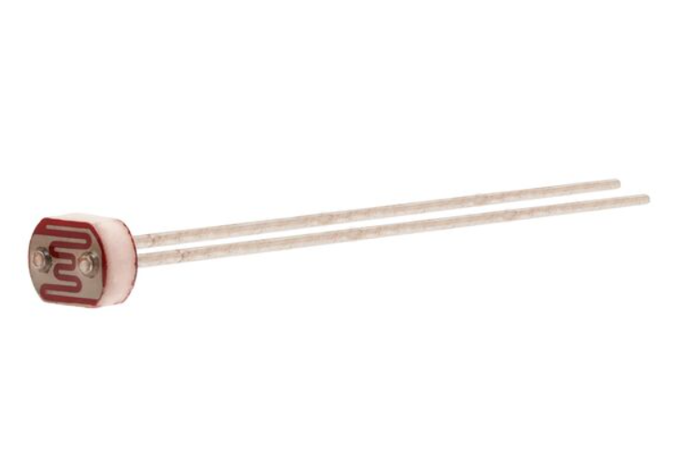

    * $0.72/each
    * [PDV-P8103](https://www.digikey.com/en/products/detail/advanced-photonix/PDV-P8103/480610?s=N4IgTCBcDaIAoBEBqBaOAOAjABgMwgF0BfIA)

    | Pros                                      | Cons                                                             |
    | ----------------------------------------- | ---------------------------------------------------------------- |
    | Low unit cost                               | Moderate resistance range may provide less sensitivity in very dim conditions |
    | Documented rise and fall times for ease of calibration                      | Its sensitivity only lists typical, making it hard to estimate variance (min and max)                                        |
    | Resistance range of 16–33 kΩ at 10 lux is suitable for a voltage-divider circuit | Slow response makes it unsuitable for tracking rapid light changes |

1. BPW34S-ND through hole photodiode

    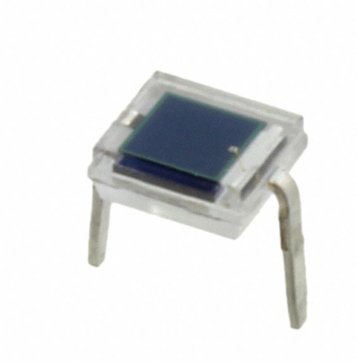

    * $2.11/each
    * [BPW34S](https://www.digikey.com/en/products/detail/vishay-semiconductor-opto-division/BPW34S/4071244)

    | Pros                                      | Cons                                                             |
    | ----------------------------------------- | ---------------------------------------------------------------- |
    | Fast response makes it suitable for detecting rapid changes in light                               | Its output is current, requiring a resistor or transimpedance amplifier to produce a useful analog voltage |
    | Wide viewing angle helps capture light from different directions                      | Near-infrared response means its output won't directly give plant-usable data without suitable filtering and calibration                                        |
    | Detects visible light as well as near-infrared radiation, making it versatile for optical sensing | Can be especially sensitive to placement |

1. QSD123 through hole phototransistor

    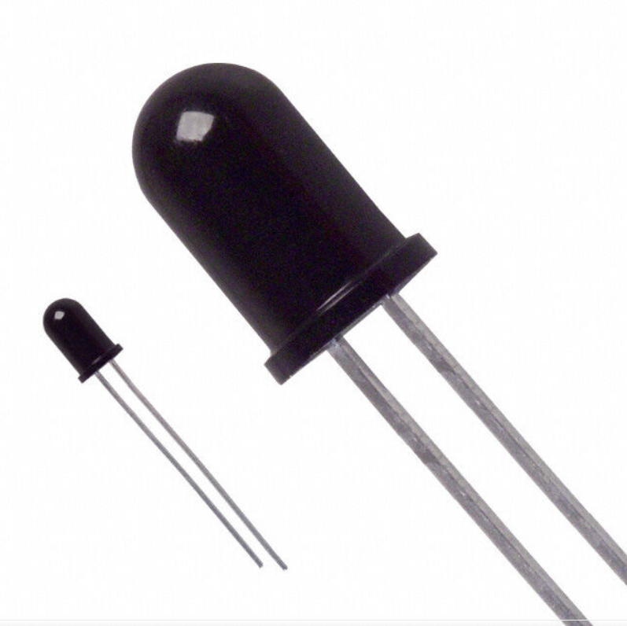

    * $2.11/each
    * [QSD123](https://www.digikey.com/en/products/detail/onsemi/QSD123/187443)

    | Pros                                      | Cons                                                             |
    | ----------------------------------------- | ---------------------------------------------------------------- |
    | Transistor action amplifies the light-generated signal                              | It is optimized for near-infrared light, not the visible spectrum used to assess typical plant lighting |
    | Its typical rise and fall times are around 7 μs, much faster than an LDR                      | Doesn’t require amplifying circuit as per requirements                                        |
    | Its narrow reception angle can help measure light from a specific direction | Its output depends on the infrared spectrum, geometry, and circuit design so must be designed especially carefully |

**Choice:** PDV-P8103 through hole photoresistor

**Rationale:** The PDV-P8103 is the best choice for our plant monitor because it is inexpensive, has a practical resistance range, and has documented response-time specifications. These characteristics allow us to detect changes in light intensity and compare the readings with thresholds based on the plant’s lighting requirements. Additionally, its variable resistance can be easily converted into an analog voltage using a simple voltage divider, allowing the sensor to interface directly with a microcontroller’s analog input. It is also the simplest to implement while following course guidelines. 

## Amplification
**Op Amp**

1. TLV272IP through hole Op Amp

    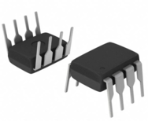

    * $1.56/each
    * [TLV272IP](https://www.digikey.com/en/products/detail/texas-instruments/TLV272IP/454247)

    | Pros                                      | Cons                                                             |
    | ----------------------------------------- | ---------------------------------------------------------------- |
    | High 3 MHz bandwidth                               | Higher power consumption than MCP6004 |
    | Wide 2.7–16 V supply range                      | Input is not rail-to-rail                                        |
    | Multiple channels in one IC | Less channels than MCP6004-I/P |

1. MCP6004-I/P through hole Op Amp

    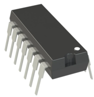

    * $0.60/each
    * [MCP6004-I/P](https://www.digikey.com/en/products/detail/microchip-technology/MCP6004-I-P/523060)

    | Pros                                      | Cons                                                             |
    | ----------------------------------------- | ---------------------------------------------------------------- |
    | Four channels in one IC                               | Lower bandwidth (1 MHz) than TLV272IP and TL974IN |
    | Low power consumption (100 µA/channel)                      | Limited to a 6 V maximum supply                                  |
    | Rail-to-rail input and output; operates from 1.8–6 V | Slower slew rate (0.6 V/µs) than the other two |

1. TL974IN through hole Op Amp

    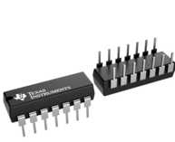

    * $1.66/each
    * [TL974IN](https://www.digikey.com/en/products/detail/texas-instruments/TL974IN/1675406)

    | Pros                                      | Cons                                                             |
    | ----------------------------------------- | ---------------------------------------------------------------- |
    | Highest bandwidth (12 MHz)                               | Higher power consumption (2 mA/channel) |
    | Four channels in one IC                      | Input is not rail-to-rail                                  |
    | Low noise and rail-to-rail output | Maximum supply is 12 V, lower than the TLV272IP's 16 V |

**Choice:** MCP6004-I/P through hole Op Amp

**Rationale:** The MCP6004-I/P is the best choice because it provides four operational amplifiers in one package while consuming relatively little power. This is particularly important for our design because it allows us to amplify multiple sensor signals without needing several separate ICs. Its rail-to-rail input and output and compatibility with common 3.3 V and 5 V supplies also make it easier to interface with our embedded system. While it has a lower bandwidth than the TLV272IP and TL974IN, its 1 MHz bandwidth should be sufficient for our low-frequency sensor signals. Additionally, while all three options are compelling, the MCP6004-I/P is the cheapest and therefore more budget-friendly.

## Power Regulation
**Voltage Regulators**

1. NJM7805FA through hole Linear Voltage Regulator

    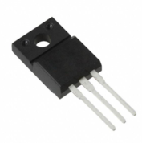

    * $1.85/each
    * [NJM7805FA](https://www.digikey.com/en/products/detail/nisshinbo-micro-devices-inc/NJM7805FA/805763)

    | Pros                                      | Cons                                                             |
    | ----------------------------------------- | ---------------------------------------------------------------- |
    | Fully insulated TO-220F package for electrical isolation                               | Maximum operating temperature is 85°C |
    | Specified ripple rejection of 78 dB at 120 Hz allows for better stability                      | Insulated package interferes with heatsink capabilities                                        |
    | Over Temperature, Short Circuit protection | More expensive than L7805ABV-DG |

1. L7805ABV-DG through hole Linear Voltage Regulator

    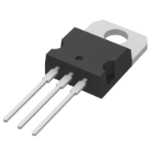

    * $1.53/each
    * [L7805ABV-DG](https://www.digikey.com/en/products/detail/stmicroelectronics/L7805ABV-DG/3945936)

    | Pros                                      | Cons                                                             |
    | ----------------------------------------- | ---------------------------------------------------------------- |
    | Low cost compared with the MIC29151                             | Requires approximately 7 V or more input to maintain 5 V output under typical full-load conditions |
    | Supports input voltages up to 35 V                      | Greater voltage drop creates more heat when the input voltage is much higher than 5 V                                  |
    | Built-in thermal shutdown, current limiting, and safe-operating-area protection | No enable pin for controlling the regulator through logic |

1. MIC29151-5.0WT through hole Linear Voltage Regulator

    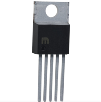

    * $4.96/each
    * [MIC29151-5.0WT](https://www.digikey.com/en/products/detail/microchip-technology/MIC29151-5-0WT/771578)

    | Pros                                      | Cons                                                             |
    | ----------------------------------------- | ---------------------------------------------------------------- |
    | Low dropout voltage (600 mV maximum at 1.5 A) allows operation with an input closer to 5 V                               | More expensive than traditional 7805 regulators |
    | Built-in reverse-polarity, overcurrent, and overtemperature protection improve circuit safety                      | Five-pin package requires more connections than a standard three-pin regulator                                  |
    | Enable pin allows the microcontroller or other logic to turn the regulator on and off | Maximum input voltage is 26 V, lower than the 35 V rating of the other two options |

**Choice:** L7805ABV-DG through hole Linear Voltage Regulator

**Rationale:** The L7805ABV-DG is the best choice because it provides a reliable 5 V output at a low cost and includes built-in thermal shutdown and current limiting. This is particularly important for our plant monitor because it needs a stable power supply for the microcontroller and sensor circuits without adding unnecessary cost or complexity. Although the NJM7805FA offers similar protection features, it is more expensive and does not provide a significant advantage for our design. The MIC29151-5.0WT has a lower dropout voltage and an enable pin, but these features are not essential if our wall adapter provides sufficient input voltage. Therefore, it offers the best balance of cost, simplicity, and performance for our project.

## Power
**Power Sources**

1. YSV12-1201000-D1J AC to DC Wall Adapter

    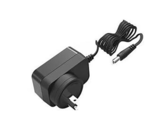

    * $7.95/each
    * [YSV12-1201000-D1J](https://www.jameco.com/z/YSV12-1201000-D1J-Yingjiao-Interchangeable-AC-Clip-Wall-Power-Adapter-12VDC-1A-with-2-1mm-DC-Plug-AC-Clips-Included-_2735095.html)

    | Pros                                      | Cons                                                             |
    | ----------------------------------------- | ---------------------------------------------------------------- |
    | Provides stable, regulated power for continuous monitoring                               | Requires a nearby AC outlet and limits portability |
    | Can supply up to 12 W          | Costs more initially than the battery holder                                        |
    | Includes overload, overvoltage, and short-circuit protection | Its 12 V output must be stepped down, adding a regulator and associated circuitry |

1. KXOB25-12X1F-TR Solar Cell

    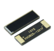

    * $1.53/each
    * [KXOB25-12X1F-TR](https://www.digikey.com/en/products/detail/anysolar-ltd/KXOB25-12X1F-TR/10127240)

    | Pros                                      | Cons                                                             |
    | ----------------------------------------- | ---------------------------------------------------------------- |
    | Uses renewable energy                             | Maximum output is only 24.5 mW, requiring many cells |
    | Very small and lightweight                      |  Its 0.56 V operating voltage requires boost circuitry                                  |
    | Suitable for an outdoor monitor exposed to sunlight | Reliable overnight operation requires additional energy storage |

1. 36-2477-ND Battery Holder and E91VP AA Batteries

    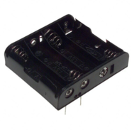
    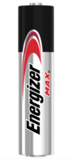

    * $1.99/each - Battery Holder
    * [36-2477-ND](https://www.digikey.com/en/products/detail/keystone-electronics/2477/303822)

     * $0.42/each (at 620 pcs; consistent with retail) - AA Batteries
    * [E91VP](https://www.digikey.com/en/products/detail/energizer-battery-company/E91VP/14267522)

    | Pros                                      | Cons                                                             |
    | ----------------------------------------- | ---------------------------------------------------------------- |
    | Inexpensive holder at $1.99                               | Batteries must be purchased separately and eventually replaced |
    | Mounts directly to the PCB using through-hole pins                      | Cells provide only about 1.5V each, lower margin to 5V requirement                                  |
    | Batteries are replaceable, so the monitor can operate without a wall outlet | Battery voltage declines with discharge, and runtime depends on battery capacity and system current |

**Choice:** Yingjiao YSV12-1201000-D1J wall adapter

**Rationale:** The Yingjiao YSV12-1201000-D1J wall adapter is the best choice for our plant monitor because it provides a stable, regulated 12 V DC supply with sufficient current capacity to power the microcontroller, light sensor, and other system components. This is particularly important because the monitor needs consistent power to collect light measurements and compare them against thresholds based on the plant's lighting requirements. Unlike battery-powered alternatives, the wall adapter does not require periodic battery replacement or recharging, making it reliable for continuous indoor operation. It also requires much simpler circuitry compared to the solar cells to connect to the PCB, as well as less components.