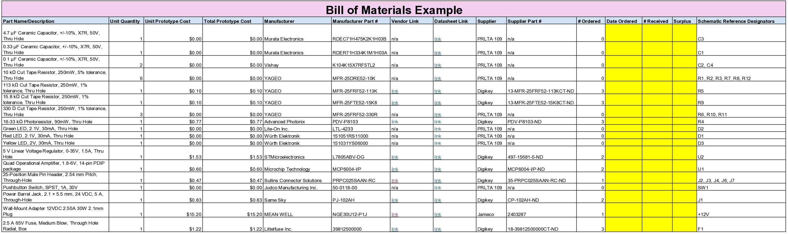

## Overview
This Bill of Materials documents Team BAMF's light sensor module, with all the necessary parts (with suppliers and datasheets) per prototype unit. This serves as documentation to the necessary parts that make up the subsystem, so it can be referred to and replicated.

Some important notes: The unit quantity is how many of the component in the individual module, the unit cost is how much each individual component costs, and the total prototype cost is how much a it would cost to complete a prototype with the parts. # Ordered is extra parts for breadbaording and replacements if need be, not how many are necessary.

<!-- ## Bill of Materials Example (as Table)

*Table ##: An example of one approach to adding your BOM table to this section.*

| **Part Name/Description** | **Qty** | **Unit Cost** | **Total Cost** | **Manufacture** | **Manufacturer #** | **Vendor Link** |**Datasheet Link** | **Schematic Reference Designators** |
|:--------------------|:----|:---------------|:-----|:--------|:-----|:-----|:----|:-----|
8-bit SIPO/SISO Shift Register, SOIC-16 package | 1 | $0.49 | $ 0.49 | NXP | 74HC595D,112 | [DigiKey](https://www.digikey.com/en/products/detail/nexperia-usa-inc/74HC595D-112/763550) | [datasheet link](https://assets.nexperia.com/documents/data-sheet/74HC_HCT595.pdf) | U1 |
0.1 µF Ceramic Capacitor, +/-10%, X7R, 50V, 0805 package |10 | 0.2750 | $2.75 | KEMET | C0805F104K5RACTU | PRLTA 109 |n/a | C2, C4, C6, C7, C8, C9, C10, C11, C12, C16

Note: Setting it up as a table is nice because it is completely viewable without scaling issues. <ins>Downside</ins> is that you have to do the math.

* You could also import your BOM via a screenshot of the spreadsheet created BOM -->

## Bill of Materials
{style width: "2000"}
**Figure 2:** Team BAMF Light Sensor Bill of Materials

## Resources
The BOM as a PDF download is available [*here*](BOM.pdf), and a Microsoft Excel Sheet [*here*](BOM.xlsx).