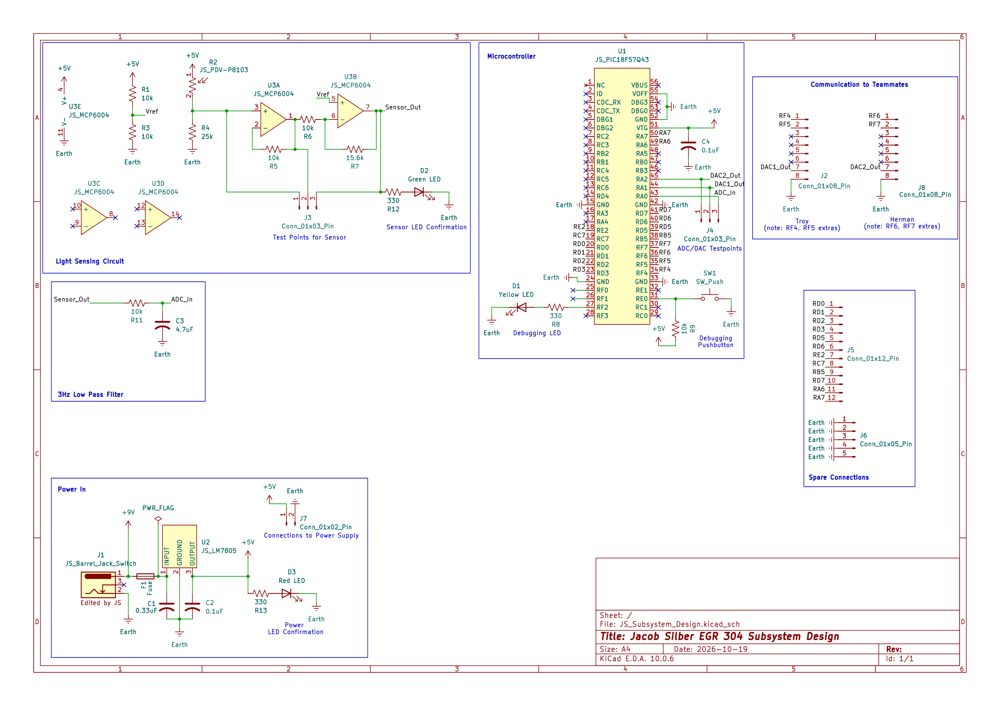

## Overview

This schematic is designed to support Team BAMF's Plant Monitor system by introducing a light sensing circuit to sense the ambient light around the plant and compare it to the necessary light, sending signals to a motor connected to a shade to increase or decrease light amount (depending on what's necessary), and data to a screen letting users know what status the plant's lighting is in (good/bad). 

It does so by using a photoresistor to detect light as an impedance, which then is amplified by an op-amp to generate a complete signal as a voltage. This voltage is communicated to the PIC18F57Q43 Curiosity Nano micrcontroller for ADC to DAC processing, finally being sent as an analog signal to the motor on another board and UART data to the screen on another board. The whole system is powered by a wall adapter connected to a barrel jack, regualted by a linear voltage regulator outputing 5V.

**NOTE:** Github is currently not displaying images, so let this note be a placeholder until image display returns. PDF of image is submitted to Canvas.

{style width:"350" height:"300;"}
**Figure 1:** Team BAMF Light Sensor schematic.

## Resources

The schematic as a PDF download is available [*here*](JS_Subsystem_Design.pdf), and the Zip folder of the project [*here*](JS_Subsystem_Design_schematic.zip).