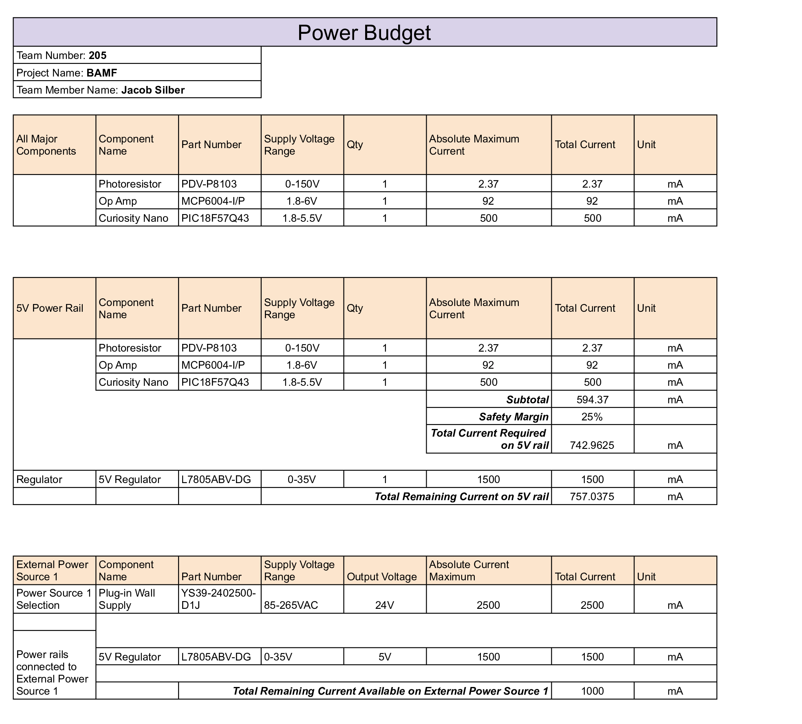

## Overview
A power budget is necessary to ensure that the power source and voltage regulators can provide enough power for every component in the system. It helps prevent power shortages, voltage drops, and overloaded components while ensuring the system operates reliably. It also helps determine the appropriate power supply and estimate battery life if the system is battery-powered.

First, all major components and their maximum current requirements were identified using their datasheets. Next, the components were assigned to appropriate voltage rails, and their current requirements were totaled with an additional 25% safety margin. Then, suitable voltage regulators and an external power source were selected to meet the system's power requirements. Finally, the available current was checked to ensure the power source could support all components.

**Figure 4:** Team BAMF Light Sensor Power Budget

## Conclusions

From the prepare Power Budget, the L7805ABV-DG voltage regulator is rated for up to 1.5 A, leaving approximately 757.04 mA of available current capacity on the rail. The selected 12V wall supply can provide up to 2.5 A, while the regulator is listed as drawing 1.5 A, leaving 1 A of remaining current capacity at the source. Overall, the listed current ratings suggest that the system has sufficient current capacity to operate, even with the safety margin. Additionally, the fuse was selected to be 2.5A based on the maximum amperage that can be supplied by the power supply for expandability purposes.
## Resources

The power budget as a PDF download is available [*here*](PowerBudget.pdf), and a Microsoft Excel Sheet [*here*](PowerBudget.xlsx).