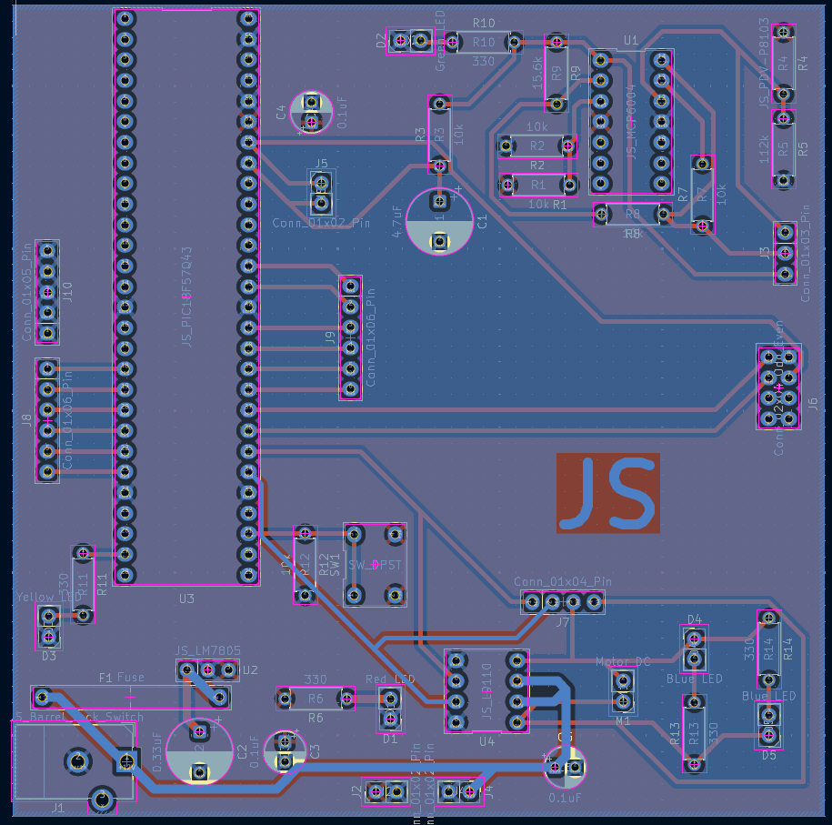
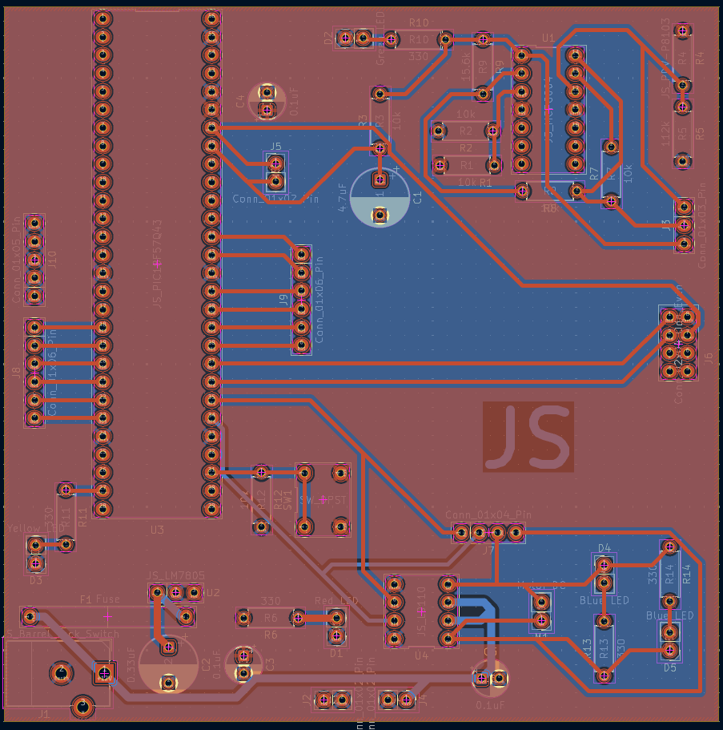

## Overview

This PCB is designed to support the schematic section of this datasheet, along with the Gerber files.

**Figure 6:** Team BAMF Light Sensor PCB.

## Resources

The PCB as a PDF download is available [*here*](JS_PCB.pdf), and the Zip folder of the project [*here*](JS_Subsystem_Design.zip). The Zip folder of the associated Gerber files is available [*here*](JacobSilber_210_Gerber.zip).